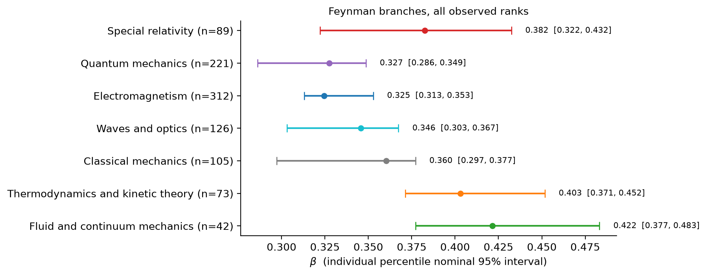

# Exploring variation in the exponential metalaw of physics

<div align="center">

<a href="writeup/main.pdf"></a>
<a href="https://jaysen-ma.github.io/physics-metalaw/data/catalog/index.html"></a>

</div>

A personal research project revisiting the inflationary difference, comparisons with modified gravity, and variation across physics branches.

> **Work in progress.** This README, the [write-up](writeup/main.pdf), and the [formula ledger](https://jaysen-ma.github.io/physics-metalaw/data/catalog/index.html) are still being updated. Reported numbers and wording may change.

## Current analysis

The reported analysis fits a normalised exponential by **log least squares**. Uncertainty uses whole-equation bootstrap samples; a joint chapter bootstrap accounts for equations sharing source chapters across branches.

The Feynman benchmark estimate is 0.342 and Encyclopaedia Inflationaris 0.269. The tested constant rewritings change their point-estimate gap from 0.073 to 0.071. The f(R) catalog has 37 closed forms. Its log-least-squares fit is 0.270, with nominal interval [0.264, 0.347], which overlaps the inflationary interval.

**The writeup reports fitted rates with individual percentile bootstrap intervals.** Branch estimates range from 0.325 to 0.422. Fluid and continuum mechanics and quantum mechanics have non-overlapping individual intervals under both equation and chapter resampling. This is a descriptive comparison; the writeup does not report a formal test that all rates are equal.

| Branch | Equations | β | Nominal individual 95% interval |
|---|---:|---:|---|
| SR | 89 | 0.382 | [0.322, 0.432] |
| QM | 221 | 0.327 | [0.286, 0.349] |
| EM | 312 | 0.325 | [0.313, 0.353] |
| Waves+optics | 126 | 0.346 | [0.303, 0.367] |
| Classical | 105 | 0.360 | [0.297, 0.377] |
| Thermo | 73 | 0.403 | [0.371, 0.452] |
| Fluid+continuum | 42 | 0.422 | [0.377, 0.483] |



## Calibration and sensitivity

Across 200 equal-rate datasets in each of three scenarios, individual interval coverage ranged from 0.745 to 0.945, with the lowest coverage in the chapter-dependent scenario. The nominal 95% intervals are therefore not consistently calibrated in these checks. These are synthetic count vectors, not real expression trees.

Removing or reassigning ambiguous chapters moves the special-relativity estimate from 0.382 to 0.231. The writeup reports fitted rates and individual intervals for the assignment, notation and Volume III sensitivity analyses. Each branch uses its own observed operator set; zero-count types are omitted.

Numerical results, bootstrap draws, failures, seeds and code/data hashes are in `results/exponential_fit/`. The corpus has 1,016 Feynman expressions, with 968 in seven branches. Source references are retained in the catalog.
## Formula ledger

```bash
.venv/bin/python -m physics_metalaw.catalog --serve --port 8766
```

Then open `http://127.0.0.1:8766/`. The *Formulas* page lists each expression with tree, counts and source; *β of each expression* plots per-expression $\beta$.

## Reproduce

```bash
.venv/bin/python scripts/exponential_bootstrap.py
.venv/bin/python scripts/exponential_coverage_check.py
.venv/bin/python -m unittest discover -s tests -t .
```

The primary pipeline uses 10,000 equation resamples, joint stratified chapter resampling and all observed operator ranks. It writes `results/exponential_fit/summary.json`, `draws.npz`, generated LaTeX tables and every current manuscript figure, along with an archived-purpose EI ten-expression subset histogram that is no longer included in the manuscript. The simulation check uses 200 datasets per scenario, 400 bootstrap samples and three workers. Small diagnostic runs use separate subdirectories and do not overwrite the primary outputs.

The saved results and analysis scripts retain the earlier pairwise calculations for reproducibility; those calculations are not reported in the current writeup. The former trimmed analysis, source files and writeup are archived in `results/previous_trimmed_bootstrap/`. Earlier permutation results remain separate. `scripts/make_plots.py` writes legacy figures to `results/legacy_figures/`; the primary figures are generated by `exponential_bootstrap.py`. The older `branch_test.py` still generates legacy LaTeX tables: rerun the primary pipeline before compiling if it has been used.

Catalog inputs live in `data/catalog/`; rebuilding the corpora requires the original extraction inputs. Cambridge material remains local and is not included in these results.

## Data sources and attribution

- **The Feynman Lectures on Physics**, Vol. I–III, R. P. Feynman, R. B. Leighton and M. Sands, New Millennium Edition, © California Institute of Technology, [feynmanlectures.caltech.edu](https://www.feynmanlectures.caltech.edu/). Each extracted expression links to its equation (e.g. `https://www.feynmanlectures.caltech.edu/I_11.html#Eq:I:11:6`) and records volume, chapter, section and equation number.
- **AI Feynman benchmark**: S.-M. Udrescu and M. Tegmark, *AI Feynman: a physics-inspired method for symbolic regression*, Science Advances 6, eaay2631 (2020), as distributed with [arXiv:2408.11065](https://arxiv.org/abs/2408.11065).
- **Wikipedia**, [List of scientific equations named after people](https://en.wikipedia.org/wiki/List_of_scientific_equations_named_after_people) (CC BY-SA 4.0); each expression links to its article.
- **Encyclopaedia Inflationaris**: J. Martin, C. Ringeval and V. Vennin, Phys. Dark Univ. 5–6, 75 (2014), [arXiv:1303.3787](https://arxiv.org/abs/1303.3787).
- **Leemis**: L. M. Leemis and J. T. McQueston, *Univariate distribution relationships*, The American Statistician 62, 45 (2008); [chart](https://www.math.wm.edu/~leemis/chart/UDR/UDR.html).
- **f(R)**: T. P. Sotiriou and V. Faraoni, *f(R) theories of gravity*, Rev. Mod. Phys. 82, 451 (2010), [arXiv:0805.1726](https://arxiv.org/abs/0805.1726), and papers cited per expression in the ledger.

## Citation

This work builds on

```bibtex
@article{constantin2024metalaw,
  title   = {Statistical Patterns in the Equations of Physics and the Emergence of a Meta-Law of Nature},
  author  = {Constantin, Andrei and Bartlett, Deaglan J. and Desmond, Harry and Ferreira, Pedro G.},
  journal = {arXiv preprint arXiv:2408.11065},
  year    = {2024}
}
```
